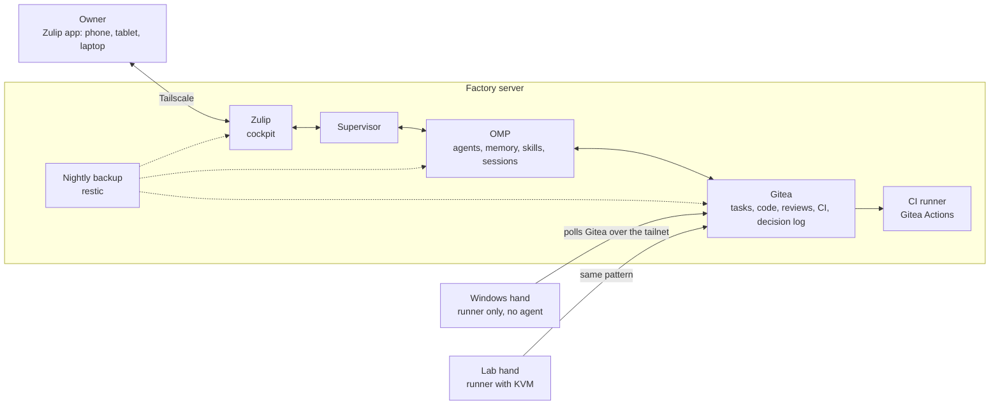

# Software Factory

[](LICENSE)

A self-hosted **AI software factory**: one person leads several software products from a chat app on a phone, tablet
or laptop, and AI agents do the planning, building, testing, reviewing and releasing in between. The owner files
requests, approves plans, answers questions and decides merges; everything else runs on one server.

- **One interface.** The owner works only in [Zulip](https://zulip.com) (mobile and desktop apps). No terminal, no
  SSH, no consoles.
- **Durable.** Every task's state is kept outside chat, in Gitea: restarts and model usage limits pause work, they
  never lose it.
- **Automatic quality.** Gates (Gitea Actions) run on every push; red gates go back to the agent; a merge needs green
  gates or the owner's explicit, logged override.
- **Product-neutral.** Products are tenants with their own repository, channel, agent account, playbooks, machines
  and secrets. A new product is created from Zulip (`/product new`) and onboarded with a few plain-word answers.
- **Private.** Every service listens only on a [Tailscale](https://tailscale.com) tailnet; the server opens no public
  port besides SSH. Secrets never appear in chat, and release signing keys never reach agents or CI.

## Architecture

Everything that thinks or remembers lives on **one factory server**; other machines are only "hands" that run jobs.



| Component | Role |
|---|---|
| **Zulip** | The owner's only interface: one channel per product, one topic per task; requests, plans, questions, approvals, the daily digest. |
| **Supervisor** | A small Python service ([supervisor/](supervisor/)). It turns requests into tasks, runs the agents headless, bridges each agent to its Zulip topic, enforces the [decision policy](docs/decision-policy.md), paces work against model usage limits, waits for the gates and records every owner action. It writes no code itself. |
| **OMP** | [oh-my-pi](https://www.npmjs.com/package/@oh-my-pi/pi-coding-agent), the agent runtime, installed once on the server and run headless (`--mode rpc`). Each product's agents run as their own unprivileged Unix user with their own OMP profile; the model login is held by one auth broker. |
| **Gitea** + PostgreSQL | The system of record: tasks (issues), code, pull requests, CI and the decision log. |
| **Hands** | Optional machines that run a product's Windows or VM jobs as Gitea Actions runners scoped to that product. No agent and no OMP on a hand. |
| **Signer** | Signs release packages of successful `main` builds outside CI, so the key never enters Gitea, a repository or an agent's workspace. |
| **Backup** | Nightly encrypted restic snapshot of everything; one command restores the factory onto another server. |

Read more:

| Document | What it says |
|---|---|
| [docs/vision.md](docs/vision.md) | Why the factory exists, and what "done" looks like for the owner |
| [docs/architecture.md](docs/architecture.md) | The one-server design: Zulip, Gitea, one OMP installation, machines that are only "hands" |
| [docs/workflow.md](docs/workflow.md) | The stations a request passes through, and where the owner is involved |
| [docs/decision-policy.md](docs/decision-policy.md) | What agents decide alone and what always needs the owner |
| [docs/decisions.md](docs/decisions.md) | The design decisions, with the reason |
| [docs/specs/](docs/specs/) | Component specifications: cockpit (Zulip), supervisor, OMP runtime, model access, records (Gitea), products, security, packaging |

## Install

**What you need**

- A server with **Ubuntu 24.04 LTS** (x86-64), **16 GB RAM**, **150 GB disk** and 4 vCPU: a cloud server or a VM.
  You sign in as `root` (or a sudo user) with your SSH key. No domain, no extra address and no open port are needed.
- A **Tailscale** account (MagicDNS and HTTPS certificates on, in the admin console under DNS) and the Tailscale app
  on your phone.
- A model login for **OMP** on your own computer (`omp login <provider>`). Which provider and plan you use, and their
  terms, are your choice.
- The **Zulip** app on your phone (Android or iOS).

**A new, empty factory**

```bash
ssh root@<server>
git clone <URL of this repository> software-factory
sudo env FACTORY_OWNER_EMAIL=you@example.com FACTORY_OWNER_NAME="Your Name" \
  bash software-factory/infra/factory.sh install
```

`FACTORY_OWNER_EMAIL` is your sign-in to Zulip; `FACTORY_REALM_NAME` (default `Software Factory`) names the Zulip
organisation. Installation takes about 7 minutes, is idempotent and prints no secret. It sets up Docker, Tailscale
(installed, not joined), restic, the server firewall, Zulip, Gitea with PostgreSQL and the CI runner, the supervisor,
OMP and its auth broker, the agent users, the nightly backup and the signer. At the end it lists your remaining
steps:

1. **Tailnet:** `sudo bash /opt/factory/software-factory/infra/factory.sh tailnet --hostname factory-core` shows a
   link and a QR code: open it on your phone and approve the server. The supervisor starts then.
2. **Zulip password:** `sudo bash /opt/factory/software-factory/infra/factory.sh owner-link` prints a one-time link;
   open it with Tailscale on, choose your password, then turn on two-factor sign-in.
3. **Push notifications:** only after you have read and accepted [Zulip's terms](https://zulip.com/policies/terms):
   `sudo bash /opt/factory/software-factory/infra/factory.sh push-register`.
4. **Model login:** on your computer `omp auth export > factory-login.json`, copy the file to the server, then
   `sudo bash /opt/factory/software-factory/infra/factory.sh import-login factory-login.json` (the file is deleted).
5. **Phone:** in the Zulip app, add the organisation `https://<the name step 1 shows>/`.

The first product, `sandbox`, is ready for a request. Create your own products from Zulip with `/product new`.

To run the factory in a VM instead: [infra/host/mk-factory-vm.sh](infra/host/mk-factory-vm.sh) creates one on a KVM
host, and [infra/host/hyperv/create-factory-vm.ps1](infra/host/hyperv/create-factory-vm.ps1) on a Windows PC with
Hyper-V (adjust the paths in the script). Their admin user is `factory`; the commands above already use `sudo`.

**Hands (optional).** A lab hand (VM tests under KVM) runs on the factory server itself, when it has `/dev/kvm`, for
products that declare `hands: [lab]`. A Windows hand is installed with
[infra/hands/windows/install-windows-hand.ps1](infra/hands/windows/install-windows-hand.ps1) (run once, elevated;
pass `-GiteaUrl https://<server>.<tailnet>.ts.net:8443` and the folders the hand must never read as `-DenyPath`), and
checked with [check-isolation.ps1](infra/hands/windows/check-isolation.ps1). See
[docs/specs/security.md](docs/specs/security.md#hands).

<!-- usage:start -->
## How to use the factory (from Zulip)

_Generated from `supervisor/factory_supervisor/commands.py` by `infra/gen-readme-usage.py`; the same text is posted by `/help` in Zulip. Do not edit by hand._

**How to use the factory**

*Zulip basics.* A channel is like a folder; a topic is like an email subject: messages with the same topic form one conversation. The **Inbox** shows every topic with unread messages; tap a channel to see all its topics.

*Answering on the phone (the most important part).*
- To answer a plan or a question, **tap the notification** (or open the task's topic `#<n> …` in the product's channel) and type your reply at the bottom of **that** topic. Example: in topic `#3 Exam simulator` type `approve`.
- **Every message in topic `requests` becomes a new task.** Write one message per job there; follow-ups, answers and approvals go in the task's own topic. (If you type `approve` elsewhere, the factory applies it when only one task is waiting, or lists the waiting tasks to choose from.)
- Type topic names without `/` (e.g. `requests`, `onboarding`, `chat`); commands start with `/`, topics do not.
- This guide is always in topic `how to use` of each channel, and `/help` shows it in any topic.

*Channels.*
- `factory`: chat with the factory's assistant, the daily digest (topic `digest`) and anything across products.
- One channel per product (e.g. `sandbox`): that product's requests and tasks. Create a product with `/product new <name> <title>`; it gets its channel, its Gitea project and its own agent, and asks you a few questions in its topic `onboarding` (what it is, stack, build and test, hands, first goals). Answer in plain words; its agent prepares the README, the gates and 3-5 backlog issues as one pull request; read it and reply `merge with gate change: <reason>` to accept (it sets up the gates). `/backlog start <n>` turns a backlog issue into a task.

*Working, step by step.*
1. **Talk:** start any topic in `factory` (e.g. `chat`) and write normally: ask about status, tasks or decisions, discuss ideas, ask for research. When you are happy, write "make this a task".
2. **Or ask directly:** write the job in topic `requests` of a product's channel (or of `factory` for sandbox).
3. **Plan:** a task topic `#<n> <title>` opens in the product's channel and the agent posts a plan there (you get a notification). Reply `approve`, `change: <what>` or `reject` (or react ✅ / ❌).
4. **Build and checks:** the agent builds; the gates run on every push (✅ / ❌ in the topic). Red gates go back to the agent (up to `gates.max_fixes` tries), then it asks you.
5. **Merge:** with green gates reply `merge`; it merges only when the gates are green. If the pull request changes the gates themselves (onboarding always does), read that change and reply `merge with gate change: <reason>`. To ship with red gates on purpose: `merge anyway: <reason>`. If it conflicts with the default branch (or needs a touch-up after it was done), reply `rework` or `rework: <note>`: the agent updates it and the gates run again.

*Good to know.*
- In a task topic you can always write to its agent, or use `/pause`, `/resume`, `/cancel`, `/status`.
- Files and images you attach (requests, task topics, chat) reach the agent in its workspace under `attachments/` (up to 25 MB each; types: png, jpg, jpeg, gif, webp, svg, pdf, txt, md, csv, tsv, json, yaml, yml, xml, log, html, docx, xlsx, pptx, zip).
- Model usage: the factory pauses new work when the 5-hour or 7-day usage window of the model account passes its threshold (`/settings`), says so in the topic and continues after the reset. `/status` and `/digest` show both.
- Phone notifications come for plans, questions, results and the digest. If none arrive, check Android's Do Not Disturb and Zulip's battery setting.
- Only your account (organisation owner) can give commands or approve; every decision is logged.

**Commands**
- `/help` — any topic: This list.
- `/status` — any topic: In a task topic: this task. Elsewhere: all tasks (of this product in its stream), queue and model usage.
- `approve  (or react ✅ on the plan)` — task topic: Approve the plan; the agent builds it on branch task/<n>, the factory opens a pull request and runs the gates; red gates go back to the agent (up to `gates.max_fixes` times), then to you.
- `change: <what to change>` — task topic: Ask for a revised plan.
- `reject  (or react ❌ on the plan)` — task topic: Reject the plan; the task is cancelled and its issue closed.
- `merge · /merge · merge with gate change: <reason> · merge anyway: <reason> · merge anyway with gate change: <reason>` — task topic: Merge this task's pull request into the default branch (release playbook): only with green gates on its head and no conflicts; otherwise it says why. A pull request that changes the gates (`.gitea/workflows/`, or the product's declared gate files) is refused with plain `merge`, because gates run from the agent's branch: read the change, then use `merge with gate change: <reason>`. `merge anyway: <reason>` ships it with red or missing gates (still no conflicts; the gate-change rule still applies, then `merge anyway with gate change: <reason>`). Recorded in the decision log with the reason.
- `rework · rework: <note> · /rework [note]` — task topic: Send a done or paused task with a pull request back to its agent: it merges the default branch into its branch (resolving conflicts) and does what the note says; the gates run again, then `merge`.
- `/pause` — task topic: Stop this task's agent now; nothing runs until /resume.
- `/resume` — task topic: Continue a paused task (also after a time limit or an error).
- `/cancel` — task topic: Stop and cancel this task; its issue is closed and its workspace removed.
- `/model · /model list · /model <name> · /model default <name> · /model role <smol|slow|plan> <name>` — any topic: Show models; use <name> for this topic's agent from its next turn; set the factory default or a role model for new sessions.
- `/thinking <level> · /thinking default <level>` — any topic: Thinking level (off, minimal, low, medium, high, xhigh, max) for this topic's agent from its next turn, or the factory default.
- `/settings · /settings set <key> <value> · /settings reset <key>` — any topic: Show the agent settings the factory manages; change or reset one (recorded in the decision log).
- `/product list · /product new <name> [title] · /product remove <name>` — stream factory: List products; create one (name: lowercase letters, digits, hyphens): its Gitea organisation and repository, its stream `<name>`, its agent user and token, live, then the onboarding questions in its topic `onboarding`; remove one with no open tasks (deletes its repository, stream and agent user).
- `/onboarding · /onboarding skip` — a product's channel: Post the onboarding questions (again) in topic `onboarding`: your answers there become a pull request with the README, the real gates and the hands, plus 3-5 backlog issues; `merge with gate change: <reason>` accepts it (it changes the gates). `skip`: no onboarding (the default gates stay).
- `/backlog · /backlog start <n>` — a product's channel: List the product's backlog (open issues labelled `backlog`, not started); start issue <n> as a task (its own topic: plan, approve, build, gates, merge).
- `/report <what went wrong> · /report list` — any topic: Report a problem with the factory itself (not a product: product bugs go in `requests` as `Bug: …`). It is recorded with the time, this topic's link, your attachments and the factory's recent log in the factory records (label factory-report) and listed in the digest; `list` shows the open reports.
- `/digest` — any topic: Post the daily digest now in #factory > digest (tasks per product, waiting decisions, done, model usage, backups, paused). It is posted every day at `digest.time` (see /settings).
<!-- usage:end -->

## Move or reinstall the factory

Everything the factory knows (Zulip with all messages, Gitea with all tasks and code, the agents' memory, the
supervisor's state, settings and secrets) is in its nightly backup, encrypted with the password in
`/srv/factory/secrets/restic_password`. Keep a copy of that password and of the backup repository
(`/srv/factory-backup/restic`) off the server: [infra/offsite/pull-backup.py](infra/offsite/pull-backup.py) mirrors it
to a Windows PC every day (Task Scheduler; SSH host alias `factory-core`; `--dest` sets the folder).

The order is **backup → restore on the new server → stop the old server → take over → approve Tailscale on the
phone.** Nothing changes for the owner until the old server stops; Zulip is offline for about 10 minutes.

1. **Copy the backup and its password to the new server** (from your off-site copy):
   `scp -r <backup copy>/restic root@<new>:restic` and `scp <password file> root@<new>:restic-password`.
2. **Rehearsal restore** on the new server, safe while the old one runs (no model login, no supervisor, no push, not
   on the tailnet; it ends with "Rehearsal restore done" and Zulip and Gitea at HTTP 200):
   ```bash
   git clone <URL of this repository> software-factory
   sudo bash software-factory/infra/factory.sh restore --from ~/restic --password-file ~/restic-password
   ```
3. **Stop the old server:** `sudo bash /opt/factory/software-factory/infra/factory.sh stop` stops the agents, writes
   the final backup (tagged `final`), stops Zulip and Gitea and takes the server off the tailnet.
4. **Bring the final backup over** (repeat step 1 with a fresh copy).
5. **Tailscale:** remove the old machine in the admin console (**Machines → ⋯ → Remove**), so the new server can take
   the same name and every link keeps working.
6. **Take over** on the new server:
   ```bash
   sudo bash /opt/factory/software-factory/infra/factory.sh restore --from ~/restic --password-file ~/restic-password --take-over
   ```
   It refuses unless the backup is the old server's final one (add `--old-is-gone` if the old server is lost). It
   shows a Tailscale link and a QR code; approve the server on your phone and the command carries on: Zulip and
   Gitea go on the tailnet, the supervisor and the agents start, and the nightly backup is on.
7. **Done.** The Zulip app works as before: same address, same account, same messages. Delete `~/restic-password`.

Details: [docs/specs/packaging.md](docs/specs/packaging.md).

## Signed release packages

The factory signs its products' release packages itself (Android is built; Windows is a hook only). A signing key is
the product's identity, so it never goes into Gitea (not even as a secret), a repository, an agent's workspace or a
model's context: any workflow on a `task/*` branch, which the agents write, could read a Gitea secret. Instead the
CI builds an **unsigned** release package on every branch, and the **signer** on the factory server
([infra/signer/factory-signer](infra/signer/factory-signer), user `factory-signer`, no login, no Docker) signs only
packages from successful gates runs on `main`, which only the owner's `merge` reaches. Every 5 minutes it takes the
newest successful run, signs the artifact (apksigner, schemes v2 and v3), verifies it against the product's key and
publishes a Gitea pre-release `android-<commit>` with `<Name>-<version>-<commit>.apk`. Only the signer's bot may
create or delete `android-*` tags.

**The product's CI contract.** On every branch push (`on: push: branches: ['**']`), build the release package
unsigned and upload it with `actions/upload-artifact@v3` under a fixed artifact name holding one fixed file name.

**Turn on signing for a product** (on the factory server):

```bash
sudo bash /opt/factory/software-factory/infra/signer/add-product.sh <org/repo> <artifact> <file> <key> --new-key
```

`--new-key` makes the key on the server (RSA 4096, 30 years; set the certificate's subject with
`factory-signer add … --dn`); copy `/srv/factory/signer/keys/<key>.jks` and `<key>.txt` to your vault straight away.
To use an existing key, give `--import <keystore> <info-file>` (lines `alias=`, `store_password=`, `key_password=`)
instead. Keys are in the encrypted nightly backup; `factory.sh restore` brings them back. Status:
`sudo factory-signer status`.

## Licence

The Software Factory is **source-available**, not open source. It is published under the
[PolyForm Noncommercial License 1.0.0](LICENSE): you may read, run, change and share it for any **noncommercial**
purpose — personal study, research, testing, hobby projects, and use by charities, schools, public research,
public safety or health organisations and government institutions.

**Commercial use** of any kind, including running it to build products you sell or offering it as a service, needs a
licence from UXSYSTEMS. Ask through this repository's GitHub Issues.

The components the factory installs and builds on (Zulip, Gitea, PostgreSQL, Tailscale, restic, OMP, act_runner and
others) keep their own licences and terms; the factory downloads them from their publishers during installation.

---

<div align="center"><sub>© UXSYSTEMS. Licensed under the PolyForm Noncommercial License 1.0.0.</sub></div>
