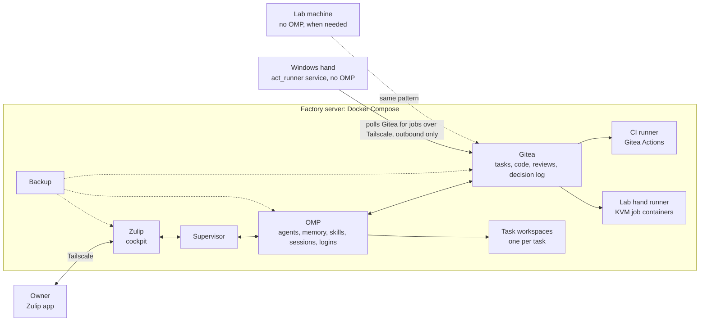

# Architecture

## Principle: one brain, many hands

Everything that thinks or remembers lives on **one factory server**. Other machines only execute.

## Components on the factory server

| Component | Role | Spec |
|---|---|---|
| **Zulip** | The owner's only interface: requests, progress, questions, approvals, digest. One stream per product, one topic per task. | [specs/cockpit-zulip.md](specs/cockpit-zulip.md) |
| **Supervisor** | Small service. Turns requests into tasks, starts and resumes OMP sessions, links each session to its Zulip topic, enforces the decision policy and usage pacing, writes everything to Gitea, sends the digest. Does no coding itself. | [specs/supervisor.md](specs/supervisor.md) |
| **OMP** | The single agent runtime: planners, builders, reviewers; skills (playbooks); long-term memory; MCP tools; logins. | [specs/omp-runtime.md](specs/omp-runtime.md) |
| **Gitea** + PostgreSQL | System of record: tasks, repositories, reviews, CI, decision log. | [specs/records-gitea.md](specs/records-gitea.md) |
| **CI runner** | Gitea Actions runner; the gates of each product on every push. | [specs/records-gitea.md](specs/records-gitea.md) |
| **Task workspaces** | A clean working directory (or container) per task with the product's repository and tools; removed when the task ends. OMP runs the agent there, still part of the one installation. | [specs/omp-runtime.md](specs/omp-runtime.md) |
| **Tailscale** | All access, the owner's and the hands', over the tailnet only; no public ports. | [specs/security.md](specs/security.md) |
| **Backup** | Nightly dumps of Gitea, Zulip and the OMP home, off-site. | [specs/packaging.md](specs/packaging.md) |

## Hands (optional, per product)

| Machine | When needed | What runs there |
|---|---|---|
| Windows machine (e.g. the current build PC) | Products with Windows builds, .NET or Windows tests | A Gitea Actions runner (label `windows`); build tools. No signing keys: release packages are signed by the factory signer on the server (D22) |
| Lab machine (KVM or Hyper-V) | Products with VM labs | A Gitea Actions runner (label `lab`) whose jobs boot VMs |
| Extra Linux builder | Builds or tests too heavy for the factory server | Docker, build tools |

A product without such needs uses only the factory server.

### As built (F4, 18 Oct 2026)

- **A hand is a Gitea Actions runner, nothing else** (D8: no OMP, no agent, no SSH from the factory). It connects
  out to Gitea over the tailnet, takes the jobs labelled for it, and reports results and logs back to Gitea. Agents
  never log in to a hand: they put the step in a gates job (`runs-on: windows` / `runs-on: lab`) and push; the
  supervisor reports that job like any gate and gives a failing log to the agent.
- **Per product:** a product declares its hands in `products/<name>/product.yml` (`hands: [lab]`). The hands the
  factory knows, and what agents are told about each, are in `supervisor/config.yml` (`hands`). A hand's runner is
  registered to the product's **Gitea organisation**, not the whole instance, so only that product's workflows reach
  it; a second product on the same machine gets its own registration.
- **Lab hand: built, on the factory VM** (it has `/dev/kvm`, nested virtualisation). One runner container per
  product that declares `lab` (`lab-<org>`, [infra/hands/lab](../infra/hands/lab/)), started by `update.sh`; jobs
  run in the image `factory-lab:1` (QEMU, a baked Alpine 3.22.4 cloud image, `factory-vm-run`) with `/dev/kvm`
  passed in, unprivileged. `factory-vm-run SCRIPT` boots a throwaway copy-on-write VM, runs SCRIPT in it and exits
  with its code; about 35 s per VM. Fine for small VM tests; real lab work (Windows VMs, several VMs)
  needs a lab machine.
- **Windows hand: ready to install.** [infra/hands/windows](../infra/hands/windows/): act_runner
  0.6.1 in host mode as the Windows service `factory-hand` (WinSW 2.12.0), running as the local standard user
  `factory-hand`, label `windows`, under `D:\factory-hand`. It needs one elevated run on the target PC.

## Sizing

- **Factory server alone** (Zulip, Gitea, supervisor, OMP, light builds): about 4–8 vCPU, 16 GB memory, 200 GB disk.
- **With heavy builds on the same server:** 64 GB memory or more; or keep heavy builds on a separate hand.
- **Labs** need real virtualisation: bare metal (for example a dedicated server) or a desktop with Hyper-V/KVM.
