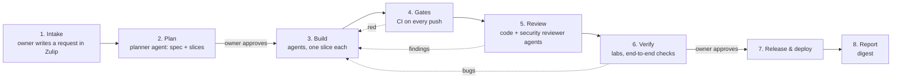

# Workflow

A request passes through stations. The owner appears at three points (filing, plan approval, release approval) and
answers decisions, which arrive batched.

| Station | Who | Output (in Gitea) | Owner sees in Zulip |
|---|---|---|---|
| 1. Intake | Owner | Task with the request text and attachments | Confirmation and task number |
| 2. Plan | Planner agent | Spec, slices, risks, estimate | **Approve / change / reject** |
| 3. Build | Builder agents | Branches and commits per slice | Progress lines in the topic |
| 4. Gates | CI | Gate results | Only failures that agents cannot fix |
| 5. Review | Reviewer agents | Review findings and fixes | Only findings needing a decision |
| 6. Verify | Agents, hands | Evidence (logs, screenshots, reports) | Summary |
| 7. Release | Release agent | Tag, artefacts, deployment record | **Approve release**, then result |
| 8. Report | Supervisor | Digest record | Daily digest; weekly summary per product |

## Kinds of work (playbooks)

General playbooks, used by every product: feature, bug fix, refactor, documentation, dependency update, release,
incident. Product playbooks add product-specific steps (for example: a Hyper-V lab, an appliance build,
Windows signing, localised help). Playbooks are OMP skills. Built (F3, [skills/](../skills/)): feature, bug fix, documentation, refactor
and release (the owner's `merge` with green gates); stations 4 (gates) and 7 (merge into the default branch) run as
described in [specs/supervisor.md](specs/supervisor.md#flow); review and verify stations are not built yet.

## Pausing and resuming

A usage limit, a restart or a missing decision **pauses** a task; the topic says why and until when. The supervisor
resumes it from its saved state. Nothing waits silently.
